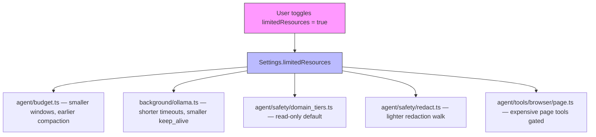

# World-Class Limited Resources Implementation Plan

> **For agentic workers:** REQUIRED SUB-SKILL: Use `superpowers:executing-plans` to implement this plan task-by-task. Steps use checkbox (`- [ ]`) syntax for tracking.

**Goal:** Add an opt-in `limitedResources` mode so the on-device browser agent can run acceptably on constrained hardware (small context window, low RAM/VRAM, one slow local model) without changing any behavior when the flag is off — byte-identical to the current baseline.

**Architecture:** A single settings flag (`Settings.limitedResources`, default `false`) gates six downstream constrictions: context/budget sizing, Ollama call timeouts/keepalive, domain-tier fail-closed default, redaction walk depth, and page-tool availability. Every constriction is a no-op passthrough when the flag is false, so the off path is structurally byte-identical — guaranteed by code (omit/identity checks), not by comment.

**Tech Stack:** TypeScript, Vitest, existing `Settings`/`DEFAULT_SETTINGS`, `agent/budget.ts`, `background/ollama.ts`, `agent/safety/*.ts`, `agent/tools/browser/page.ts`.

Spec: `docs/architecture-map.md` (budget & context window §, safety layer §, page-level tools §)

## Before you start

Read `extension/src/shared/messages.ts` (Settings + DEFAULT_SETTINGS), `extension/src/agent/budget.ts`, `extension/src/background/ollama.ts`, `extension/src/agent/safety/domain_tiers.ts`, `extension/src/agent/safety/redact.ts`, `extension/src/agent/tools/browser/page.ts`. Run `npm test` once to confirm a clean baseline before starting.

---

### Task 1: Settings gate — `limitedResources` flag (this session)

**Files:**
- Modify: `extension/src/shared/messages.ts` (add `limitedResources?: boolean` after `structuredToolCalls`, default `false` in `DEFAULT_SETTINGS`)
- Test: `extension/tests/unit/limited_resources.test.ts` (new)

Depends on: nothing.

- [ ] **Step 1: Write the failing test (RED)**

  Create `extension/tests/unit/limited_resources.test.ts` asserting:
  - `DEFAULT_SETTINGS.limitedResources` toBe `false`
  - a `Partial<Settings>` missing the `limitedResources` key merges to the baseline

- [ ] **Step 2: Run test to confirm failure**

  `cd extension && npx vitest run tests/unit/limited_resources.test.ts`
  Expected: FAIL — property does not exist yet (runtime `undefined` ≠ `false`; merge test adds a key baseline lacks).

- [ ] **Step 3: Implement the flag + default (GREEN)**

  In `messages.ts`:
  - add `limitedResources?: boolean;` immediately after `structuredToolCalls?: boolean;` (around line 101)
  - add `limitedResources: false,` immediately after `structuredToolCalls: false,` in `DEFAULT_SETTINGS` (around line 143)

- [ ] **Step 4: Run test + typecheck**

  `cd extension && npx vitest run tests/unit/limited_resources.test.ts; echo EXIT:$?` → must be 0.
  `cd extension && npm run typecheck` → must be 0.

- [ ] **Step 5: Commit**

  `git add extension/src/shared/messages.ts extension/tests/unit/limited_resources.test.ts`
  `git commit -m "feat(settings): add limitedResources gate, default false (byte-identical off)"`

---

### Task 2: Budget constriction under limitedResources

**Files:**
- Modify: `extension/src/agent/budget.ts`
- Test: `extension/tests/unit/budget.test.ts` (additions)

Depends on: Task 1.

- [ ] Step 1: Write failing test — when `limitedResources` is true, `budgetsFor`/`capsFor` return smaller windows (e.g. executor budget scales down, observed page cap stays fixed but smaller), `clampNumCtx` defaults to a lower floor.
- [ ] Step 2: Run → FAIL.
- [ ] Step 3: Implement — `budgetsFor`/`capsFor` accept an optional `limitedResources: boolean` (default false → unchanged outputs, byte-identical).
- [ ] Step 4: Run → PASS; `npm run typecheck` → 0.
- [ ] Step 5: Commit.

---

### Task 3: Ollama client constriction under limitedResources

**Files:**
- Modify: `extension/src/background/ollama.ts`
- Test: `extension/tests/unit/ollama_chat_error.test.ts` (additions) or new `ollama_limited.test.ts`

Depends on: Task 1.

- [ ] Step 1: Write failing test — when `limitedResources`, chat call timeout and `keep_alive` shrink; a `limitedResources` option on `OllamaClient`/chat opts is honored; off = unchanged request shape.
- [ ] Step 2: Run → FAIL.
- [ ] Step 3: Implement — accept `limitedResources?: boolean` in chat options; map to shorter timeout + smaller keep_alive; default false = current behavior byte-identical.
- [ ] Step 4: Run → PASS; `npm run typecheck` → 0.
- [ ] Step 5: Commit.

---

### Task 4: Domain-tier fail-closed default under limitedResources

**Files:**
- Modify: `extension/src/agent/safety/domain_tiers.ts`
- Test: `extension/tests/unit/domain_tiers.test.ts` (additions)

Depends on: Task 1.

- [ ] Step 1: Write failing test — when `limitedResources`, unknown/unparseable hosts fail closed to `read-only` and `click-only` requires an explicit per-domain opt-in; bypass flag still honored; off = unchanged enforcement.
- [ ] Step 2: Run → FAIL.
- [ ] Step 3: Implement — thread `limitedResources` into `assertCanAct`/`getDomainTier` decision; default false = current behavior.
- [ ] Step 4: Run → PASS; `npm run typecheck` → 0.
- [ ] Step 5: Commit.

---

### Task 5: Redaction walk depth under limitedResources

**Files:**
- Modify: `extension/src/agent/safety/redact.ts`
- Test: `extension/tests/unit/redact_extra.test.ts` (additions)

Depends on: Task 1.

- [ ] Step 1: Write failing test — when `limitedResources`, `redactDeep` on large tool findings caps recursion depth / skips non-PII branches to bound CPU; `redactEvent` (values-only, depth 8) unchanged; the five PII patterns still caught; off = byte-identical.
- [ ] Step 2: Run → FAIL.
- [ ] Step 3: Implement — `limitedResources?: boolean` option on redaction entry points; default false = current behavior.
- [ ] Step 4: Run → PASS; `npm run typecheck` → 0.
- [ ] Step 5: Commit.

---

### Task 6: Page-tool gating under limitedResources

**Files:**
- Modify: `extension/src/agent/tools/browser/page.ts`
- Test: new unit test for page-tool gating

Depends on: Task 1.

- [ ] Step 1: Write failing test — when `limitedResources`, expensive page tools (`page.fetch`, `dom.query` full-text, `page.wait_for_mutation`) are refused with an actionable message unless explicitly allowed; `page.expect` (cheap deterministic check) still allowed; off = all page tools available as today.
- [ ] Step 2: Run → FAIL.
- [ ] Step 3: Implement — gate page-tool dispatch behind `limitedResources` opt-in; default false = current behavior.
- [ ] Step 4: Run → PASS; `npm run typecheck` → 0.
- [ ] Step 5: Commit.

---

## File → constriction map

| File | Constriction when `limitedResources: true` | Behavior when `false` (off) |
|---|---|---|
| `extension/src/shared/messages.ts` | New flag `limitedResources?: boolean`, default `false` | Byte-identical Settings shape minus nothing new |
| `extension/src/agent/budget.ts` | Smaller per-role budgets, earlier compaction, lower ctx floor | Unchanged `budgetsFor`/`capsFor`/`clampNumCtx` outputs |
| `extension/src/background/ollama.ts` | Shorter chat timeout, smaller `keep_alive` | Unchanged request bodies & timings |
| `extension/src/agent/safety/domain_tiers.ts` | Read-only default; click-only needs explicit opt-in | Unchanged tier enforcement |
| `extension/src/agent/safety/redact.ts` | Bounded redaction walk on large findings | Unchanged `redactEvent`/`redactDeep` |
| `extension/src/agent/tools/browser/page.ts` | Expensive page tools refused unless allowed | All page tools available |

## Coverage checklist

- [ ] `DEFAULT_SETTINGS.limitedResources` is `false`
- [ ] A `Partial<Settings>` missing `limitedResources` merges to the baseline
- [ ] `npm test` passes with zero regressions
- [ ] `npm run typecheck` exits 0
- [ ] Off path is byte-identical (nothing consumes the flag until Tasks 2–6 wire it)
- [ ] Each constriction task has its own failing-then-passing test
